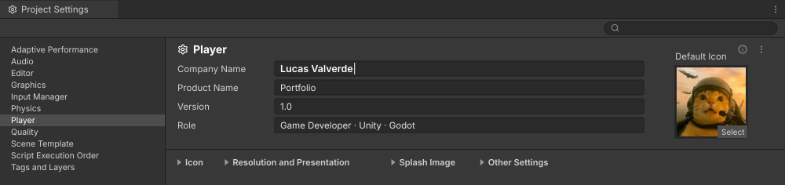
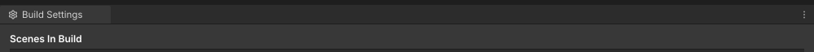
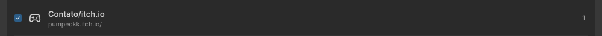
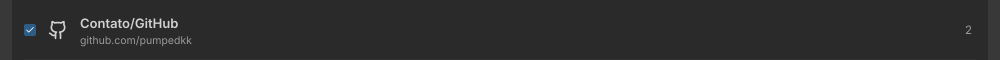
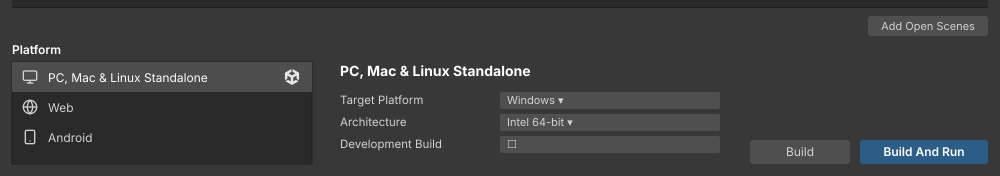

<a href="https://www.linkedin.com/in/lucas-valverde-866053269"><picture><source media="(prefers-color-scheme: light)" srcset="assets/light/banner.svg"></picture></a> <a href="https://pumpedkk.itch.io/"><picture><source media="(prefers-color-scheme: light)" srcset="assets/light/editor.svg"></picture></a> <picture><source media="(prefers-color-scheme: light)" srcset="assets/light/project-tree.svg"></picture><a href="https://uupedrin.itch.io/demissao-suja"><picture><source media="(prefers-color-scheme: light)" srcset="assets/light/cover-demissao-suja.svg"></picture></a><a href="https://uupedrin.itch.io/late-night-sandwich"><picture><source media="(prefers-color-scheme: light)" srcset="assets/light/cover-sanduiche-da-meia-noite.svg"></picture></a><a href="https://uupedrin.itch.io/unframed"><picture><source media="(prefers-color-scheme: light)" srcset="assets/light/cover-unframed.svg"></picture></a><a href="https://pumpedkk.itch.io/misterjhonny"><picture><source media="(prefers-color-scheme: light)" srcset="assets/light/cover-misterjhonny.svg"></picture></a><picture><source media="(prefers-color-scheme: light)" srcset="assets/light/filler.svg"></picture> <picture><source media="(prefers-color-scheme: light)" srcset="assets/light/profiles.svg"></picture> <picture><source media="(prefers-color-scheme: light)" srcset="assets/light/tilemap.svg"></picture> <picture><source media="(prefers-color-scheme: light)" srcset="assets/light/build-header.svg"></picture> <a href="https://www.linkedin.com/in/lucas-valverde-866053269"><picture><source media="(prefers-color-scheme: light)" srcset="assets/light/build-row-0.svg"></picture></a> <a href="https://pumpedkk.itch.io/"><picture><source media="(prefers-color-scheme: light)" srcset="assets/light/build-row-1.svg"></picture></a> <a href="https://github.com/pumpedkk"><picture><source media="(prefers-color-scheme: light)" srcset="assets/light/build-row-2.svg"></picture></a> <a href="https://www.linkedin.com/in/lucas-valverde-866053269"><picture><source media="(prefers-color-scheme: light)" srcset="assets/light/build-footer.svg"></picture></a>

